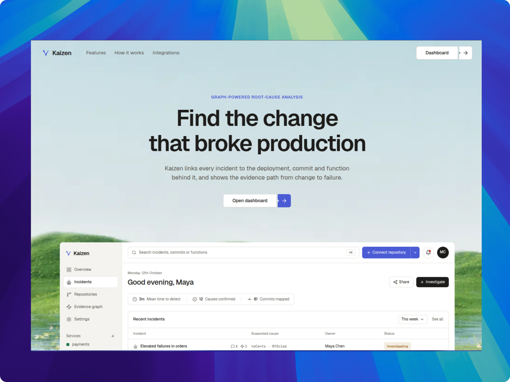
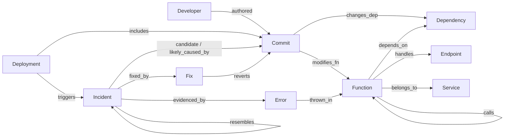

# Kaizen



**When a deploy breaks production, Kaizen tells you which commit and which function did it, before anyone opens a dashboard.**

A FalkorDB knowledge graph of your repository (commits, functions, call paths, endpoints, deployments, incidents) is walked from the failing stack trace back to the change that caused it. The answer arrives in Slack with the author and the evidence. Then Kaizen proposes a revert, verifies it, and merges nothing without a person's approval.

**Live demo:** <https://kaizen.akkki.tech> -> *Try the demo* (no account needed) -> *Graph map* -> **Inject a problem** · Walkthrough: [`docs/demo.md`](docs/demo.md)

## Why this needs a graph database

Finding the cause of an outage is a **multi-hop question**: *which commit changed a function that calls the function that threw on this endpoint, in this deploy?* Logs and keyword search cannot answer it; a graph traversal can. We measured it on 28 seeded failure scenarios, same candidates for every method, 18 of them held out from tuning:

| Method | Right commit first | Confidently wrong |
|---|---|---|
| **Kaizen (FalkorDB graph)** | **89%** | **0%** |
| Keyword search (BM25) | 39% | 61% |
| "Latest commit" | 32% | 68% |

Remove the call-path feature (`shortestPath` in FalkorDB) and top-1 falls from 89% to 57%: the graph is doing the work, not the model. The LLM never sets a score; it only explains, and every claim must cite a node the graph returned. Full table and method: [`docs/results/latest.md`](docs/results/latest.md) (replay benchmark, offline; it measures ranking quality, not live failure injection).

## How it works

```
 your repo ──GitHub App──► import ─┐                    ┌─► Slack alert (who, what, why)
 production ─telemetry────► detect ┼─► FalkorDB graph ──┼─► Graph map: only the failing node turns red
 GitHub deploys/pushes ───► update ┘   (Cypher, shortestPath,   ├─► Ranked suspects, every score with its Cypher
                                        algo.pageRank)          └─► Revert PR -> staging check -> human approval
```

1. **Connect:** sign in with GitHub, install the App, pick a repository, *Start monitoring*. Kaizen reads history and maps every function, call and endpoint (about 40 s for the demo repo).
2. **Detect:** error rate over its own baseline for two 30-second windows opens an incident with the true start time.
3. **Find the cause:** stack trace -> the function that threw -> the deployment's commits -> ten graph features score each commit. Kaizen abstains instead of guessing.
4. **Tell the team:** one Slack message with culprit, author, changed vs thrown function, confidence, link.
5. **Fix safely:** revert, verification, approval, merge. The fix is written back into the graph, so the next similar incident is recognised.

## Graph data model

One graph per repository in FalkorDB. Source of truth: [`core/src/causaldeploy/graph/schema.py`](core/src/causaldeploy/graph/schema.py); details in [`docs/graph.md`](docs/graph.md).



| Layer | Nodes | Key edges |
|---|---|---|
| Code | `Repository` `Branch` `Commit` `Developer` `File` `Function` `Service` `Endpoint` `Dependency` | `modifies_fn` `contains` `calls` `handles` `belongs_to` `depends_on` `changes_dep` `authored_by` `parent` |
| Delivery | `PullRequest` `Build` `Deployment` `Environment` `ConfigChange` `DependencyChange` | `includes` `produces` `deployed_to` `changes_config` `bumps` |
| Runtime | `Incident` `Error` `Metric` `Trace` | `triggers` `evidenced_by` `thrown_in` `observed_on` `affects` `correlated_with` |
| Reasoning | `Investigation` `ToolCall` | `candidate` `likely_caused_by` `confirmed_cause` `investigated_by` `cited` |
| Memory | `Fix` `Test` `VerificationRun` | `fixed_by` `reverts` `patches` `resembles` `verified_by` |

**What FalkorDB does here:** every ranking feature is a Cypher query (path distance with `shortestPath`, blast radius with variable-length traversals, endpoint and service reach, dependency impact, history, sequence); centrality uses the built-in `algo.pageRank`. The UI shows the query next to each score and the measured time of the queries behind the Graph map.

## Architecture

| Part | What | Tech |
|---|---|---|
| `core/` | API, auth, webhooks, jobs, detection, graph, ranking, MCP tool server, agent, remediation, evaluation | Python 3.12, FastAPI, ARQ, SQLAlchemy |
| Graph | knowledge graph, all reasoning | **FalkorDB** |
| State | raw events, incidents, audit log | Postgres, Redis |
| Agent | read-only graph tools over MCP; citations validated against the graph | MCP, OpenAI (optional) |
| `ui/` | incident page, live graph, connect flow, demo | Next.js, Tailwind, Cytoscape |
| `deploy/` | one AWS EC2 host, Caddy TLS, CI/CD with OIDC (no stored keys) | Docker Compose, CloudFormation |

Design decisions: [`docs/architecture.md`](docs/architecture.md) and [`docs/adr/`](docs/adr/). Security review: [`docs/security.md`](docs/security.md).

## Setup

Needs Docker, [`uv`](https://docs.astral.sh/uv/), Node 20+ and `make`.

**1. See the UI with no backend and no credentials (1 minute)**
```bash
git clone https://github.com/akkki007/kaizen && cd kaizen/ui
npm install && npm run dev:mock        # http://localhost:3000, fixture data
```

**2. Run the tests and the benchmark (no credentials)**
```bash
make bootstrap     # FalkorDB + Postgres + Redis in Docker, dependencies, migrations
make test          # backend tests against the real services
make eval          # graph vs baselines -> docs/results/latest.{md,json,html}
```

**3. Full stack on a real repository**
```bash
cp /path/to/team.env .env      # GitHub App credentials; or start from .env.example
make backfill REPO=owner/name  # import the repository into the graph
make api & make worker & make ui    # http://localhost:3000 (API on :8000)
# optional demo controls on that repository:
export CD_DEMO_LOGIN_ENABLED=1 CD_DEMO_INJECT_ENABLED=1 CD_DEMO_REPOS=owner/name
```
Optional settings: `CD_SLACK_WEBHOOK_URL` (alerts), `CD_OPENAI_API_KEY` + `CD_OPENAI_MODEL` (written explanation), `CD_ALLOWED_REPOS` (`*` = any installed repo). Windows, port clashes, owner steps for the GitHub App and troubleshooting: [`docs/setup.md`](docs/setup.md). Production runbook: [`docs/operations.md`](docs/operations.md).

## Hackathon disclosure

Built for WeMakeDevs Graph Hacks (FalkorDB). FalkorDB is the core of the product, not storage on the side. Public, synthetic or own data only: the demo repository is our own app, [ShopLite](https://github.com/yashchandnani07/shoplite). AI tools used during development: Claude (Anthropic) via Claude Code for planning, code and review. Inside the product, a model may write the explanation; it never decides the ranking.
