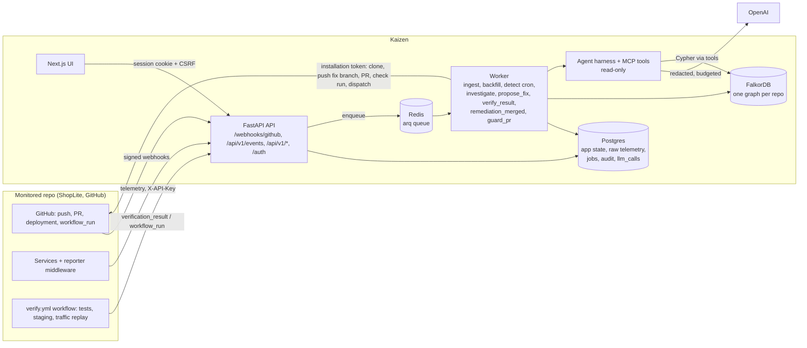

# Architecture

Kaizen connects a production failure to the code change behind it. It keeps a FalkorDB graph per
repository (code, commits, deployments, runtime evidence, incidents, fixes), ranks suspects with a
deterministic graph score, has an LLM explain the ranking with citations, proposes a revert PR,
verifies it in the repository's own CI, waits for a person to approve, and remembers the outcome.

Decisions behind this shape: [ADR 0001](adr/0001-graph-scoring-not-llm-ranking.md) (graph
scoring, not LLM ranking), [0002](adr/0002-event-contract-versioning.md) (one versioned event
contract), [0003](adr/0003-postgres-plus-falkordb.md) (Postgres + FalkorDB),
[0004](adr/0004-incident-state-machine.md) (incident state machine),
[0005](adr/0005-revert-first-human-approval.md) (revert first, human approval).

## Components



| Component | Code | Responsibility |
|---|---|---|
| API | `core/src/causaldeploy/api/` | webhooks (HMAC, dedupe), event ingest (API key, limits), incidents/remediations API, GitHub login, sessions, CSRF |
| Contracts | `contracts/` | versioned event + domain models; JSON Schema in `docs/schemas`, OpenAPI in `docs/openapi.json` |
| Jobs | `jobs/` | arq worker; every job has a `jobs` row with an idempotency key, attempts and status |
| Ingestion | `ingest/`, `github/` | backfill (clone, tree-sitter JS/TS analyzer, hunk -> function mapping), events -> graph |
| Detection | `detect/` | stack parsing, fingerprints, `thrown_in`; windowed error rate/p95 vs. baseline, consecutive windows, cooldown, health checks; opens incidents |
| Lifecycle | `incidents/lifecycle.py` | guarded status transitions with an audit row each, mirrored to the graph |
| Graph | `graph/` | schema (v4), MERGE-only write layer, core queries, evidence graph for citations |
| Investigation | `investigate/` | candidates (deployments in the lookback window, config and dependency changes), 10 features, weighted score, confidence, abstention, baselines B0/B1 |
| Agent | `agent/`, `mcp_server/` | OpenAI harness (budgets, retries, replay cache, redaction, audit), read-only graph tools, citation validator, template fallback |
| Remediation | `remediate/`, `verify/` | revert branch + PR (patch optional, off by default), verification dispatch and verdict, approval-gated merge |
| Memory | `memory/` | snapshot on resolution, confirmed root cause, `resembles` similarity, demo history |
| Guardian | `guardian/` | PR risk comment from blast radius + incident history |
| Evaluation | `evalharness/` | scenario runner, metrics, fit, report (`docs/results/`) |
| UI | `ui/` | incident list and page: suspects with per-feature Cypher, evidence graph, agent trace, fix + verification, approve/reject |

## S1 end to end: telemetry -> detect -> rank -> explain -> fix -> verify -> remember

S1 = a commit in a deployment breaks `validatePayment()`; `POST /payments` starts failing.
`core/tests/test_full_loop.py::test_s1_end_to_end` runs this whole path in CI.

1. **Telemetry.** The ShopLite reporter posts batches to `POST /api/v1/events` with a
   repository-scoped API key. Each valid event becomes an `ingest_event` job (idempotency key =
   hash of the event). The worker writes the raw row to Postgres `telemetry`; for errors it
   parses the stack, fingerprints it (type + top app frame + normalised message) and links
   `Error -[:thrown_in {frame_depth}]-> Function` (frame file/line inside the function's range at
   the deployed `sha`), `Error -[:observed_on]-> Endpoint`, `Error -[:raised_by]-> Service`.
   Request ids spanning services derive `Service -[:calls]-> Service`.
2. **Detect.** The `detect_cron` (every 30 s) computes 30 s windows per service/endpoint against a
   baseline built only from pre-onset windows; two anomalous windows in a row (error-rate delta,
   z-score, p95 factor, minimum requests) open one incident with `onset_ts` = first anomalous
   window, severity, `Metric` summaries and `Deployment -[:triggers]-> Incident`. Cooldown stops
   flapping; consecutive failed health checks also open one. Enqueues `investigate_incident`.
3. **Rank.** `open -> investigating`. Similarity to past incidents is computed first
   (`resembles {similarity, basis}`), then candidates are scored: `temporal`, `path` (shortest
   `calls` path from a changed function to a `thrown_in` function), `endpoint`, `service`,
   `dependency`, `msg_sim`, `history`, `sequence`, `centrality` (PageRank), `blast` penalty,
   `triggered`. Each feature returns `{value, evidence_ids, explanation}`. Persisted:
   `Incident -[:candidate {rank, score, features}]-> Commit|ConfigChange|DependencyChange`,
   `likely_caused_by` for a confident top-1 (tentative top 3 when ambiguous), and an
   `investigations` row (inputs, weights version, duration). Abstention returns to `open`.
4. **Explain.** If an OpenAI key (or the replay cache) is configured, the agent calls read-only
   tools (`get_incident`, `get_candidates`, `get_changed_functions`, `get_call_path`, `get_diff`,
   `get_error_samples`, `similar_incidents`, `blast_radius`, ...) and returns JSON: summary,
   causal chain, confidence, alternatives, each claim citing graph ids. The validator rejects
   unknown citations; two invalid answers fall back to a deterministic template. The trace is
   stored (`Investigation -[:step]-> ToolCall -[:cited]-> node`, `llm_calls`). Status
   `identified` or `explained`.
5. **Fix.** An approver clicks "Propose fix" (`POST /incidents/{id}/remediations`): `propose_fix`
   clones the repo with the installation token, reverts the culprit on `kaizen/fix-<incident>`
   (merge commits against the mainline), pushes, opens a labelled PR with the explanation,
   evidence links and similar prior fixes. A conflict escalates to `needs_human`. Status
   `remediating`.
6. **Verify.** Kaizen dispatches `verify.yml` in the target repo: unit tests, ephemeral compose
   staging with the fix SHA and the failing SHA, replay of the recorded traffic mix. The result
   arrives as a `verification_result` event or `workflow_run` webhook; `verify/verdict.py`
   compares failing vs fixed vs healthy-baseline metrics with tolerances and stores inputs +
   verdict (`Fix -[:verified_by]-> Test`), and a check run is posted on the PR. Failure escalates
   to `needs_human`; it never resolves the incident. Status `verifying`.
7. **Approve and merge.** Only an approver can approve a verified fix (audited). A person merges
   on GitHub (default) or, with `CD_REMEDIATION_MERGE_POLICY=app`, Kaizen merges via the API.
   The merge webhook resolves the incident only if an approval is recorded.
8. **Remember.** On resolution the incident's `memory` snapshot stores candidates, fix,
   verification and time to detect/diagnose/resolve; `confirmed_cause` and the
   `Incident -> Fix -> Test` chain are in the graph. The next similar incident (S8) finds it via
   `resembles` and the `history` feature, and the PR body cites the prior fix.

```
 reporter ─► /api/v1/events ─► jobs ─► telemetry (PG) ──► detect_cron ─► Incident(open)
                                   └─► Error-[:thrown_in]->Function (graph)        │
 GitHub push/deploy webhooks ─► backfill / events ─► Commit, Function, Deployment  │
                                                                                    ▼
                         investigate: similarity ─► rank (graph features) ─► candidate edges
                                                     └─► agent explanation (cited) ─► explained
 approver: propose fix ─► revert branch + PR ─► verify.yml ─► verdict ─► check run ─► verifying
 approver: approve ─► merge (person or app) ─► merged webhook ─► resolved ─► memory + resembles
```

## Postgres vs FalkorDB

| Postgres (`db/models.py`, Alembic migrations) | FalkorDB (`graph/schema.py`, schema v4) |
|---|---|
| raw telemetry (time-indexed, purged after 14 days) | `Error` signatures and `Metric` window summaries, never raw samples |
| incidents (status, severity, timestamps, memory snapshot), transitions | `Incident` node mirrored for traversal |
| jobs, raw webhook deliveries, API keys, repositories, installations | code: `File`, `Function`, `calls`, `handles`, `depends_on` |
| investigations, remediation runs, LLM calls, audit log | history: `Commit`, `modifies_fn`, `Deployment`, `includes`, `ConfigChange`, `DependencyChange` |
| source of truth for workflow state | reasoning: candidates, causal paths, `resembles`, `Fix`, `Test`, agent trace |

The graph is rebuildable from Git plus Postgres (backfill + replay); Postgres is the system of
record for state and audit. One graph per repository (`cd_<owner>_<name>`) isolates tenants.

## Jobs

| Kind | Trigger | Idempotency key |
|---|---|---|
| `ingest_event` | `POST /api/v1/events`, normalised webhooks | `event:<sha256 of event>`, `github:<delivery>:<i>` |
| `backfill_repo` | installation, push, re-import | `install:<repo>:<inst>`, `push:<repo>:<after>`, `reimport:<repo>:<rand>` |
| `investigate_incident` | detector | `investigate:<incident>` |
| `propose_fix` | approver action | `propose:<incident>:<rand>` |
| `verify_result` | `workflow_run` of `verify` | `verify:<repo>:<run id>` |
| `remediation_merged` | merged `kaizen/*` PR | `merged:<repo>:<pr>` |
| `guard_pr` | PR opened/synchronised | `guard:<repo>:<pr>:<head sha>` |
| crons | `detect_cron` every 30 s, `purge_job` daily 03:15 | n/a |

A failed job is retried with exponential backoff up to 5 attempts, then `dead`. A redelivered job
that already succeeded is a no-op. Effects are MERGE-based or keyed, so retries do not duplicate
them (one known exception: `docs/performance.md`, chaos checks).

## Related documents

[Graph model and query cookbook](graph.md) · [Operations runbook](operations.md) ·
[Security review](security.md) · [Performance budget](performance.md) ·
[GitHub App](github-app.md) · [Evaluation results](results/latest.md) · [Demo script](demo.md) ·
[Verification matrix](verification.md)
